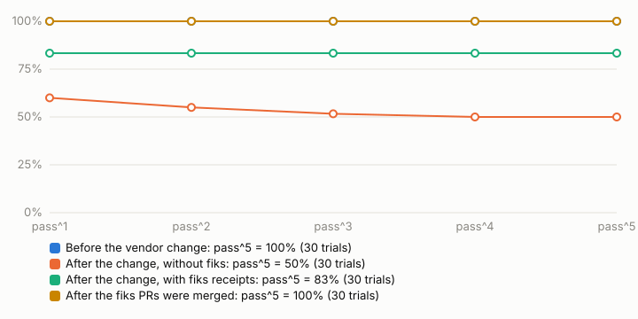

# fiks

**When a tool silently returns wrong data to an agent, fiks catches it, turns the exact failing call into a reproduction test, and opens a pull request that fixes the tool, so the failure stops recurring for every agent.**

## The 30-second pitch

- Agents rely on tool results for ground truth at each step [C1].
- MCP servers can fail *without* failing. In a study of 833 confirmed MCP runtime-fault threads, the authors observed servers returning well-formed success responses despite incorrect behavior, and conclude that crash- or error-based detection is not enough [C3]. Payloads can conform to the declared schema and still break assumptions [C4]. In one study with injected HTTP 200 responses carrying empty, null or malformed payloads, agents fabricated results in 56.6% of valid responses [C9].
- Runtime monitors help the current agent recover [C11]; we believe the tool stays broken for every future agent until someone fixes it [C12].
- The bottleneck in automated repair is a test that truly reproduces the bug [C17, C18]. A violation caught at runtime comes with the exact call, the raw upstream response and the broken property. We believe that makes it a ground-truth reproduction [C19].
- fiks closes the loop. It catches the violation in the traffic passing through its proxy, turns it into a failing test, has a coding agent fix the tool, and opens a PR only after CI is green, since each failed CI check lowers merge odds [C21]. It never merges.

We have not found another product that turns silent runtime violations into verified fix PRs [C28]. Spec-diff tools cannot see a behavior change when the spec stays the same, and error-driven autofix never gets an error [C27, C28].

## What it did here (bench)

One shopping MCP server (`shop-mcp`) wraps a mock vendor API. The vendor ships a new version with five **seeded** silent changes (D1–D5); its OpenAPI spec stays byte-identical. All numbers below come from `bench/results/` (bench), rebuilt by `pnpm fiks summarize --check`.

The bench agent is a **Claude Agent SDK agent** (claude-sonnet-5-5) with no built-in tools. It can call only the shop tools, through fiks-proxy or directly for the "without fiks" row, plus a `submit_answer` tool. A deterministic grader compares each submitted answer with the vendor's own state:
- **Correct:** the answer states the right value, even with hedges.
- **Wrong:** it states a known wrong value (also when hedged), or gives no right value and no decline.
- **Declined:** it says it could not confirm.
- **No answer:** the agent never called `submit_answer`; the trial fails.



| Phase (6 tasks × 5 trials, claude-sonnet-5-5) | pass^1 | pass^5 | Correct | Declined | Wrong answer | No answer |
|---|---|---|---|---|---|---|
| Before the vendor change, through fiks | 100% (bench) | 100% (bench) | 30 | 0 | 0 | 0 |
| After the change, without fiks | 60% (bench) | 50% (bench) | 18 | 5 | 5 | 2 |
| After the change, with fiks receipts | 83.3% (bench) | 83.3% (bench) | 25 | 5 | 0 | 0 |
| After the change, with the fiks PRs merged | 100% (bench) | 100% (bench) | 30 | 0 | 0 | 0 |

- **False positives on the old vendor version:** 0 violated receipts in 30 trials (bench).
- **The loop, run live with a Claude Agent SDK repair agent (claude-opus-5-5).** The PRs were merged on 2026-10-20 at the repo owner's request, by the assistant operating fiks with the owner's GitHub credentials. They were not reviewed line by line by a person. `fiks confirm` then re-ran each drift live on the merged `main` with zero violations and replayed every stored trace clean (bench). The merged `main` also holds #6, a test-harness-only change.

  | Vendor change | Repro fails, then passes | CI green before PR | Captured violation → PR | Agent attempts | PR | Merged and confirmed |
  |---|---|---|---|---|---|---|
  | D1 prices now in cents | yes | yes | 1.4 min (bench) | 1 | [#2](https://github.com/vats98754/shop-mcp/pull/2) | yes |
  | D2 `price` renamed to `unit_amount` | yes | yes | 1.4 min (bench) | 1 | [#1](https://github.com/vats98754/shop-mcp/pull/1) | yes |
  | D3 orders lost without a new header | yes | yes | 1.6 min (bench) | 1 | [#3](https://github.com/vats98754/shop-mcp/pull/3) | yes |
  | D4 search results paginated | yes | yes | 1.5 min (bench) | 1 | [#7](https://github.com/vats98754/shop-mcp/pull/7) | yes |
  | D5 timestamps now epoch ms | yes | yes | 1.4 min (bench) | 1 | [#4](https://github.com/vats98754/shop-mcp/pull/4) | yes |

**How to read the middle rows.**
- **Without fiks:** the agent answered "1970-01-01" for the order date in all 5 timestamp trials; 3 of them added that it might be a placeholder (bench). In 2 price trials it stated the right price in its text but never called `submit_answer`, which the grading rule counts as a failure (bench). Without those two, the without-fiks pass^5 would be 66.7%, so about half of the gap to the with-receipts row is a submission failure rather than wrong data (bench).
- **With fiks receipts:** it gave no wrong answers. Receipts state what the vendor actually sent when the tool dropped it, for example `vendor sent unit_amount = 1199 (in 20-2000 USD)`, and the agent used it as unconfirmed. The 5 declines are all the order task, where the vendor really did not save the order. We consider "could not confirm" the right answer there, though the grader counts it as a failure. The same 5 declines happen without fiks, so they are not a fiks effect (bench).
- **After the merged fixes:** every task passes with no violations, without relying on receipts.
- **The search-count task** does not separate the phases well, because the search result's `total` field still says 7 even when only one page comes back (bench).

**Receipt wording matters.** An earlier version of the receipts said only what was wrong and told the agent not to quote the value. With it, the same bench gave a pass^5 of 33.3% with fiks against 66.7% without (bench). The agent declined tasks it could have solved by reasoning around the bad data. That run, and its review from the agent's side, are kept in `bench/results/B_v2_20261018T093754` and PROGRESS.md. The current receipts add observed facts and never stop the agent from checking another tool. The earlier runs used an older harness: its prompt did not insist on `submit_answer`, and hedged wrong values counted as declines. So only the four runs dated 2026-10-20 are compared above.

## How it works

```
agent ──MCP──▶ fiks-proxy ──MCP──▶ shop-mcp ──HTTP──▶ vendor API
                   │  checks every result against an outcome contract
                   ▼
   violation ─▶ trace (exact call + raw upstream HTTP + broken property)
             ─▶ repro test in shop-mcp (must FAIL on current code, for the stated reason)
             ─▶ repair agent in a git worktree (may edit src/ only)
             ─▶ gates: repro passes, full contract suite, every stored trace, typecheck, lint
             ─▶ push, wait for CI on that exact commit ─▶ PR (only if green; never merged)
             ─▶ after the PR is merged: `fiks confirm` re-runs the call live and replays every trace
```

1. **Observe.** `fiks-proxy` sits in front of any MCP server, over stdio or Streamable HTTP. It checks each tool result against an outcome contract: the declared `outputSchema` [C26], plus semantic invariants (ranges, non-null for known-good inputs, counts, uniqueness, freshness, agreement with the upstream response) and read-after-write postconditions confirmed against the upstream [C4, C8]. Each result gets a receipt in `_meta`, a final text block, and a `fiks_receipt` field, because Claude Code shows the model only `structuredContent` (bench evidence: `bench/evidence/receipt-field`, one trial with and without the field). The upstream fields are never changed.
2. **Capture.** A violation is saved as a trace: the call, the raw upstream HTTP, the violated properties and the upstream profile.
3. **Reproduce.** The trace becomes a vitest test in the tool's repo. It must fail on the current code with an assertion that names exactly the violated properties: not "unmatched request", not "error instead of data", not anything else. It must also fail the same way on repeated runs: 3 in the current code (as for D4's PR), and 2 when the first four PRs were made.
4. **Repair.** A coding agent (Claude Agent SDK) runs in an isolated git worktree. It can edit `src/` only and run only `pnpm typecheck|lint|test`, and fiks rejects commits, test edits, and files changed after they were checked. When a fix legitimately changes upstream requests (a new header, a second page), fiks itself re-records the call against the same upstream, in a separate commit.
5. **Ship.** fiks pushes the branch, waits for CI on that exact commit, and opens a PR only if it is green. The PR body has what broke, the trace, the test, the fix, before and after, and every gate. Nothing auto-merges.
6. **Confirm.** After the PR is merged, `fiks confirm` re-runs the drift live and replays the whole suite on the merged main.

## Run it

Requirements: Node ≥ 22.12, pnpm 9, `gh` signed in, and in `.env` a Claude Code OAuth token (`claude setup-token`) as `CLAUDE_CODE_OAUTH_TOKEN`.

```bash
pnpm i && pnpm test
```

```bash
pnpm demo --drifts D1,D2,D3 --base fresh
```

The demo runs the full loop for each drift against a fresh `demo/<timestamp>` branch cut from the seed, and prints the PR URLs. It opens real PRs on `SHOP_MCP_REPO`. `--until-f-gate` stops before the model is called; that is also what happens when no Claude credential is set. More commands:

```bash
pnpm fiks scenario D2          # one drift through the proxy: see the receipt
pnpm fiks repro --scenario D2  # trace -> repro test -> F gate on the seed
pnpm fiks bench --phase B --k 5
pnpm fiks summarize --check    # rebuild summary.json from logs and compare
pnpm demo:confirm              # after merging PRs
pnpm dashboard                 # the results page
```

## Limitations

- **Seeded, not real drift.** The vendor API and its five changes are ours. Each change maps to a fault category from the MCP fault study [C3], but we have not measured precision on third-party servers.
- **Contracts only catch what they describe.** Detection outside the mined contract vocabulary is much weaker [C11]. Our contracts cannot tell a correct value from a plausible wrong one when nothing upstream says what it should be. For example, a "fix" that returns a constant in-range price would pass.
- **A passing test is not proof of a correct fix.** A fail-to-pass test can cover only one manifestation of a bug and invite partial patches [C20]. fiks also requires the full contract suite, every stored trace and golden outputs on the old vendor version, and a set of tests rejects known cheats: refusing instead of fixing, caching writes, editing tests, rewriting recordings. Still, every PR needs human review; fiks never merges.
- **Receipts can make agents over-cautious.** The first receipt wording lowered pass^k compared with no fiks (bench). The current wording fixed that on this bench, but receipt wording is a real design surface and is only tested here on one model and one tool.
- **Agent code runs on the host.** The repair agent's `src/` changes execute during the gates on the machine running fiks, with the user's environment. fiks owns the bytes it commits: it reads inputs from git, builds its own files in memory, verifies every committed blob, and requires the PR head to be the commit that passed CI. It also runs git with hooks disabled. But it does not sandbox the process, so code running on the host could still act with the user's credentials outside fiks, for example by pushing to the branch after the check. CI on GitHub's clean runner is the final gate.
- **One call at a time per upstream.** The HTTP tap serializes calls so each upstream exchange belongs to exactly one tool call.
- **The upstream must be configurable.** Upstream checks need the server to read its upstream base URL from an environment variable that fiks can point at its tap. Without a tap, those checks are skipped, and the receipt's `_meta.upstreamObserved` says so.
- **One run per phase, one model.** Each phase is 30 trials with one model on one day (bench). Each run's `meta.json` records the model, the shop-mcp commit and the fiks commit the bench ran from. For three of the four 2026-10-20 runs it also says `fiksDirty: true`. That came from the earlier runs' output files being uncommitted at the time; the `packages/` code did not differ from the recorded commit. The 2026-10-18 runs predate commit recording.
- **The loop traces came from scripted calls.** The five PRs were made from `fiks repair --scenario` runs, which send fixed calls through the proxy, not from the bench agent's traffic.

## Repository

- `packages/proxy`: fiks-proxy, receipts and the HTTP tap.
- `packages/contracts`: the outcome-contract evaluator, vendored byte-for-byte into the tool's test suite.
- `packages/repro`: traces, repro test generation, F/P gates.
- `packages/repair`: repair runner, guard, CI gate, PR body.
- `packages/bench`: tasks, grader, pass^k.
- `packages/cli`: the `fiks` command.
- `packages/vendor-api`: the mock vendor with seeded drifts.
- `apps/dashboard`: the results page.
- Demo tool: [vats98754/shop-mcp](https://github.com/vats98754/shop-mcp), unfixed seed at tag `seed-v1`.
- Evidence: `bench/results/` (trials, transcripts, proxy calls, loop events, repair results) and `bench/evidence/`.
- Claims: `RESEARCH.md` (every `[Cnn]`).
